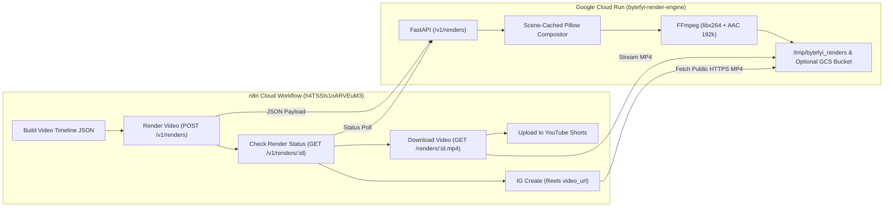

# ByteFYI Institutional Video Render Engine (`bytefyi-render-engine`)

A cloud-native, declarative JSON timeline-to-MP4 video rendering engine (`/v1/renders`), engineered specifically for automated n8n social video pipelines (**YouTube Shorts** & **Instagram Reels**) running on **Google Cloud Run**.

---

## Key Capabilities

1. **Zero Per-Render Credit Costs**: Stateless **FastAPI + Pillow + FFmpeg** microservice that scales to zero on **Google Cloud Run** (staying within the GCP Monthly Free Tier for daily video runs).
2. **Declarative JSON Timeline API**: Exposes `POST /v1/renders`, `GET /v1/renders/{id}`, and `GET /renders/{id}.mp4` for seamless integration with n8n HTTP Request, YouTube Shorts, and Instagram Graph API nodes.
3. **Broadcast-Grade Visual Quality**:
   - **Bundled TrueType Typography**: Ships with official `Inter` and `InterDisplay` (`Regular`, `Medium`, `SemiBold`, `Bold`, `ExtraBold`, `Black`) fonts inside the container for crisp, deterministic typography on both macOS and Linux.
   - **2x Supersampled Anti-Aliasing**: All rounded cards, borders, badges, and candlestick bodies are rendered at `2x` resolution and downsampled via `LANCZOS` resampling.
   - **Custom Broadcast Vector Icons**: Renders sharp anti-aliased vector graphics for `⚡` (high-voltage gold bolt), `🟢` (pulsing emerald live status dot with halo), and `🎙️` (studio broadcast microphone) so Linux containers never display missing-glyph boxes or monochrome fallback symbols.
   - **Live 30fps Audio-Synced Progress Bar**: Automatically renders a smooth cyan progress bar along the bottom of each active stock setup card.
4. **Scene-Interval Caching (`~16s` for a 93-Second 1080×1920 30fps Video)**:
   - Pre-composites static background layers and steady-state scene intervals so a full `93.36s` (`2,801` frames at `1080x1920`) vertical video encodes in ~16 seconds on CPU.

---

## System Architecture



---

## Project Structure

```text
bytefyi-render-engine/
├── app/
│   ├── __init__.py
│   ├── main.py              # FastAPI REST endpoints (/health, /v1/renders, /renders/:id.mp4)
│   ├── renderer.py          # 2x supersampled Pillow + FFmpeg JSON timeline compositor
│   └── fonts/               # Bundled Inter & InterDisplay v4.0 static TrueType (.ttf) fonts
├── docs/
│   ├── ARCHITECTURE.md      # Deep-dive into rendering engine, caching, and coordinate model
│   ├── GCP_DEPLOYMENT.md    # Google Cloud Run deployment & scaling reference
│   └── N8N_INTEGRATION.md   # How n8n nodes connect to the service
├── tests/
│   ├── fixtures/
│   │   └── execution_6550_payload.json  # Real 93.36s 354-element institutional terminal fixture
│   └── test_api.py          # Automated FastAPI + FFmpeg integration tests
├── Dockerfile               # Production Python 3.11 + FFmpeg container for Cloud Run
├── requirements.txt         # Python dependencies
└── README.md
```

---

## API Reference

### 1. `POST /v1/renders`
Renders a declarative JSON timeline payload (`source.elements` containing `shape`, `text`, `image`, and `audio` tracks) into an H.264/AAC `.mp4` video.

- **Request Headers**:
  - `Content-Type: application/json`
- **Request Body**:
  ```json
  {
    "source": {
      "output_format": "mp4",
      "width": 1080,
      "height": 1920,
      "frame_rate": 30,
      "duration": 93.36,
      "elements": [
        {
          "type": "shape",
          "x": "50%",
          "y": "50%",
          "width": "100%",
          "height": "100%",
          "fill_color": "#090D16",
          "time": 0,
          "duration": 93.36
        }
      ]
    }
  }
  ```
- **Response (`200 OK`)**:
  ```json
  {
    "id": "b032e54d-7777-461e-b877-c96f763ee51b",
    "status": "succeeded",
    "url": "https://<cloud-run-service-url>/renders/b032e54d-7777-461e-b877-c96f763ee51b.mp4",
    "output_format": "mp4",
    "render_scale": 1,
    "width": 1080,
    "height": 1920,
    "frame_rate": 30,
    "duration": 93.36,
    "file_size": 9197582,
    "render_time_seconds": 16.2
  }
  ```

### 2. `GET /v1/renders/{render_id}`
Returns the render metadata (`status: "succeeded"`, `url`, `output_format: "mp4"`, `file_size`, `duration`).

### 3. `GET /renders/{render_id}.mp4` (and `HEAD /renders/{render_id}.mp4`)
Streams the rendered `.mp4` binary with `Content-Type: video/mp4` for n8n's `Download Video` node (YouTube Shorts upload) and Meta's Instagram Graph API (`IG Create` `video_url`).

### 4. `POST /v1/image` (Aliases: `POST /v1/html-to-image`, `POST /api/v1/generateImage`)
Drop-in replacement for **HTMLCSSToImg / PDFMunk**. Renders any HTML/CSS document or snippet via headless Chromium into a crisp `.png` image (`1080x1920` default).

- **Request Body**:
  ```json
  {
    "html_content": "<!DOCTYPE html><html>...</html>",
    "css_content": "",
    "width": 1080,
    "height": 1920
  }
  ```
- **Response (`200 OK`)**:
  ```json
  {
    "id": "e184f2a1-3b7d-4e90-811b-82f01c908212",
    "status": "succeeded",
    "image_url": "https://<cloud-run-service-url>/renders/e184f2a1-3b7d-4e90-811b-82f01c908212.png",
    "url": "https://<cloud-run-service-url>/renders/e184f2a1-3b7d-4e90-811b-82f01c908212.png",
    "output_format": "png",
    "width": 1080,
    "height": 1920,
    "file_size": 184210,
    "render_time_seconds": 1.15
  }
  ```

### 5. `GET /renders/{render_id}.png` (and `HEAD /renders/{render_id}.png`)
Streams the rendered `.png` image with `Content-Type: image/png` for n8n's `Download PNG` node.

### 6. `GET /health`
Returns `{"status": "ok", "service": "bytefyi-render-engine", "version": "1.0.0"}`.

---

## Local Development & Verification

### 1. Install Dependencies
```bash
pip install -r requirements.txt
```

### 2. Run Unit & Integration Tests
```bash
python3 -m pytest -v
```

### 3. Render a Full 93.36-Second Sample Video
```bash
python3 -c '
import json
from app.renderer import render_timeline_payload_to_mp4

payload = json.load(open("tests/fixtures/execution_6550_payload.json"))
stats = render_timeline_payload_to_mp4(
    payload,
    "tests/output/sample_6550.mp4",
    save_preview_frames_dir="tests/output/frames_6550"
)
print(stats)
'
```

### 4. Start Local FastAPI Server
```bash
uvicorn app.main:app --host 0.0.0.0 --port 8080 --reload
```

---

## Deploying to Google Cloud Run

```bash
gcloud run deploy bytefyi-render-engine \
  --source . \
  --project vish-cloud \
  --region us-central1 \
  --allow-unauthenticated \
  --cpu 2 \
  --memory 2Gi \
  --timeout 300 \
  --max-instances 1 \
  --quiet
```
